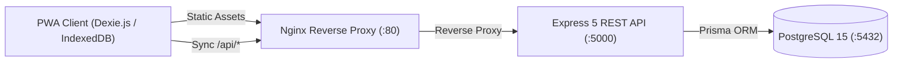

# 🌾 Farmer Procurement Application (FPC PWA)

> An offline-first, Progressive Web Application (PWA) and backend management system built for a **Farmer Producer Company (FPC)**. Digitize produce procurement at village collection centers, automate moisture deductions, eliminate weighment tampering, ensure DPDP Act compliance, and accelerate farmer bank disbursements from 12 days to 2 days.

---

## 📑 Table of Contents
1. [Quick Start (Docker Compose)](#-quick-start-docker-compose)
2. [Test Accounts & Credentials](#-test-accounts--credentials)
3. [System Architecture Overview](#-system-architecture-overview)
4. [Detailed Feature Guide](#-detailed-feature-guide)
5. [Business Logic & Formulas](#-business-logic--formulas)
6. [API Endpoints Reference](#-api-endpoints-reference)
7. [Troubleshooting & FAQ](#-troubleshooting--faq)
8. [Architecture Specification](#-architecture-specification)

---

## 🚀 Quick Start (Docker Compose)

### Prerequisites
- [Docker Desktop](https://www.docker.com/products/docker-desktop/) installed and running on your computer.

### Start All Services
Open your terminal inside the `FarmerProcurementApp` directory and run:

```bash
docker-compose up --build -d
```

The database is automatically created, schema pushed, and seeded with regional crops, today's prices, and test accounts.

| Service | Address | Technology | Purpose |
|---|---|---|---|
| **Frontend PWA** | [http://localhost](http://localhost) | React 19 + Nginx | Village Operator & Manager UI |
| **Backend API** | [http://localhost/api](http://localhost/api) | Node 22 + Express 5 | REST API & Business Logic |
| **PostgreSQL Database** | `localhost:5432` | PostgreSQL 15 | Relational Data Store |

---

## 🔑 Test Accounts & Credentials

The system pre-seeds two designated roles with full permission segregation:

| Role | Username | Password | Intended User | Permitted Capabilities |
|---|---|---|---|---|
| **Center Operator** | `operator1` | `operator123` | Village Collection Operator | Register farmers, record weighment slips, view today's price board |
| **Office Manager** | `manager` | `manager123` | FPC Central Office Executive | Verify farmer bank accounts, publish daily prices, approve payments, export bank CSV, audit AI anomalies |

---

## 📐 System Architecture Overview



*For complete in-depth architectural and engineering documentation, see [architecture.md](./architecture.md).*

---

## 🌟 Detailed Feature Guide

### 1. 👨‍🌾 Farmer Registry (`/farmers`)
- **Digital Registration:** Record farmer name, village, land area, and banking information.
- **Auto-Generated Farmer Codes:** Newly registered farmers receive a unique system code (e.g. `F-01001`).
- **DPDP Act 2023 Compliance:** Sensitive national identifiers (Aadhaar numbers) are **never requested or stored**, protecting farmers' biometric privacy.
- **Offline Storage:** New farmer records can be created even with no mobile network; they are stored locally in IndexedDB and synchronized once online.

### 2. 🏦 Bank Verification Workflow
- Newly registered farmers start in a `Pending Verification` status.
- **Security Guard:** Unverified farmers cannot be selected or procured from, protecting the FPC against payout rejections.
- **Approval:** The Office Manager reviews bank credentials under the **Manager Tools** (`/manager`) tab and clicks **"Approve Bank Details"**.

### 3. 📈 Centralized Daily Price Board (`/dashboard` & `/manager`)
- Published centrally by the Office Manager for crops (*Soybean, Tur Dal, Wheat, Onion, Cotton*) and grades (**Grade A, B, C**).
- **Tamper-Proof:** Village collection operators cannot alter rates locally, preventing rate manipulation.

### 4. ⚖️ New Procurement Weighment Slip (`/procurement`)
- Replaces manual paper receipts with an official digital weighment slip.
- Bilingual interface with Marathi labels (`एकूण वजन`, `पोत्याचे वजन`, `ओलावा`, `काटे वजन`).
- Real-time deduction calculations displayed in an official summary breakdown box.

### 5. 🚨 AI Anomaly & Fraud Detection Engine
Automated heuristic algorithms evaluate every transaction in real-time:
- **Excessive Yield Alert:** Flags if net weight exceeds 2,500 kg per hectare based on the farmer's registered land area (`"High yield for land size"`). Prevents middlemen from smuggling third-party grain under a farmer's name.
- **Velocity / Frequency Alert:** Flags if the same farmer submits produce more than once within a rolling 60-minute window (`"Farmer appeared twice in one hour"`). Prevents duplicate weighment slips.

### 6. 💳 Payment Approvals & Direct Bank Export
- Office Manager reviews procurement slips, inspects weights and AI warning flags, and approves payment.
- **1-Click Bank Disbursement File:** Downloads an official corporate banking CSV ready for direct upload to SBI, HDFC, or ICICI portals for bulk NEFT/RTGS payments:
  ```csv
  FarmerName,AccountNumber,IFSC,Amount
  Ramesh Patil,34982749283,SBIN0001234,4704.00
  ```

### 7. 🔄 Offline-First PWA Synchronization
- Collection centers operate seamlessly during complete internet outages.
- The `useSync` hook listens to browser connectivity events and flushes pending offline transactions to `/api/procurements/sync` as soon as the connection resumes.

---

## 🧮 Business Logic & Formulas

### 1. Moisture Penalty Deduction Formula
Standard acceptable grain moisture is **12.0%**. For every 1% of excess moisture above 12%, a 1% deduction penalty is applied to the net produce weight:

$$\text{Net Weight} = \text{Gross Weight} - \text{Tare Weight}$$

$$\text{Deduction \%} = \max(0, \text{Moisture} - 12.0)$$

$$\text{Final Paid Weight} = \text{Net Weight} \times \left(1 - \frac{\text{Deduction \%}}{100}\right)$$

*Example: 110 kg Gross, 10 kg Tare (100 kg Net) at 14.0% Moisture (2% excess) yields a final paid weight of $100 \times (1 - 0.02) = 98.0\text{ kg}$.*

### 2. Total Amount Calculation
Rates are published per Quintal ($1\text{ Quintal} = 100\text{ kg}$):

$$\text{Total Amount (₹)} = \left(\frac{\text{Final Paid Weight}}{100}\right) \times \text{Rate per Quintal}$$

---

## 📡 API Endpoints Reference

### Authentication
- `POST /api/auth/register` — Register a new operator or manager
- `POST /api/auth/login` — Authenticate and receive JWT bearer token

### Farmers
- `GET /api/farmers` — List all registered farmers
- `POST /api/farmers` — Register a new farmer (auto-generates `farmerCode`)
- `PATCH /api/farmers/:id/verify` — Approve farmer bank details *(Manager only)*

### Prices & Crops
- `GET /api/prices/today` — Fetch active daily price board
- `POST /api/prices` — Publish/update daily rate per crop & grade *(Manager only)*
- `GET /api/prices/crops` — List supported crops
- `POST /api/prices/crops` — Add new crop *(Manager only)*

### Procurements
- `GET /api/procurements` — List procurements (includes AI flag metadata)
- `POST /api/procurements` — Create procurement slip (applies moisture formula & AI checks)
- `POST /api/procurements/sync` — Batch synchronization endpoint for offline records
- `PATCH /api/procurements/:id/approve` — Approve payment *(Manager only)*
- `GET /api/procurements/export-bank-file` — Download bank disbursement CSV *(Manager only)*

---

## ❓ Troubleshooting & FAQ

### Q: Login fails with "Login failed. Please check credentials."
**Cause:** Docker Desktop is stopped, meaning the backend server cannot be reached.  
**Solution:**
1. Open **Docker Desktop** from your Windows Start Menu and wait until the whale icon shows running.
2. In your terminal, run `docker-compose up -d`.
3. Try logging in again at [http://localhost](http://localhost).

### Q: UI appears outdated or shows old styles.
**Cause:** PWA Service Worker has cached previous assets.  
**Solution:** Press **`Ctrl + Shift + R`** (hard refresh) or open [http://localhost](http://localhost) in an **Incognito Window** (`Ctrl + Shift + N`).

---

## 📖 Architecture & Deployment Specifications

For detailed engineering, architecture, and deployment specifications, see:
- 👉 **[architecture.md](./architecture.md)** — In-depth system design, component breakdown, ER diagrams, and offline sync protocol.
- 👉 **[deployment.md](./deployment.md)** — Multi-stage Docker containerization, Nginx proxy setup, healthcheck orchestration, and production maintenance.
