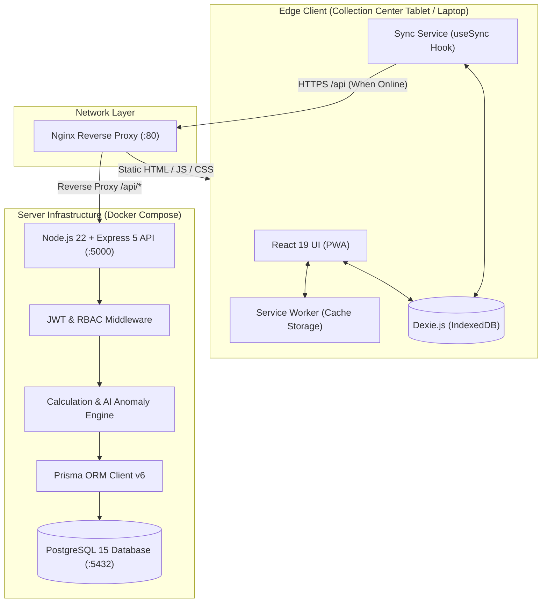
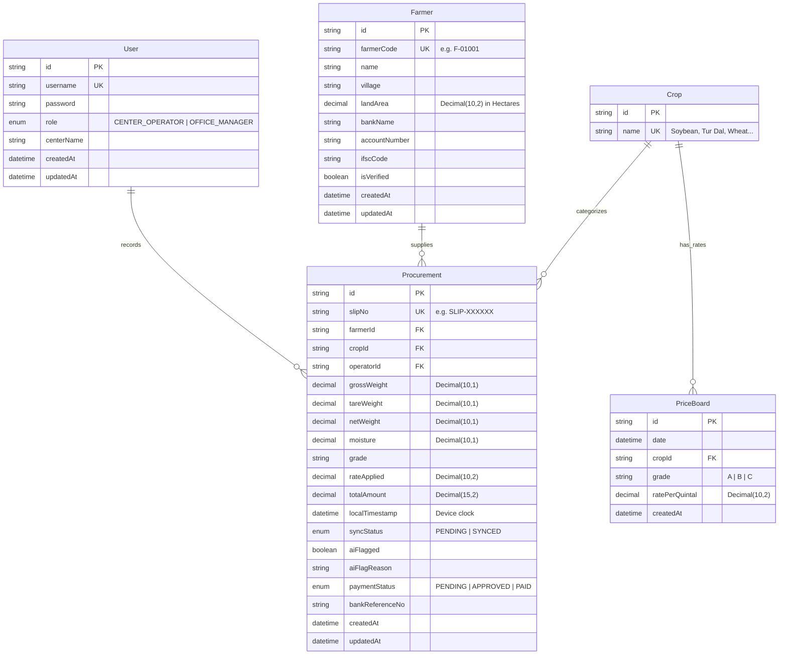
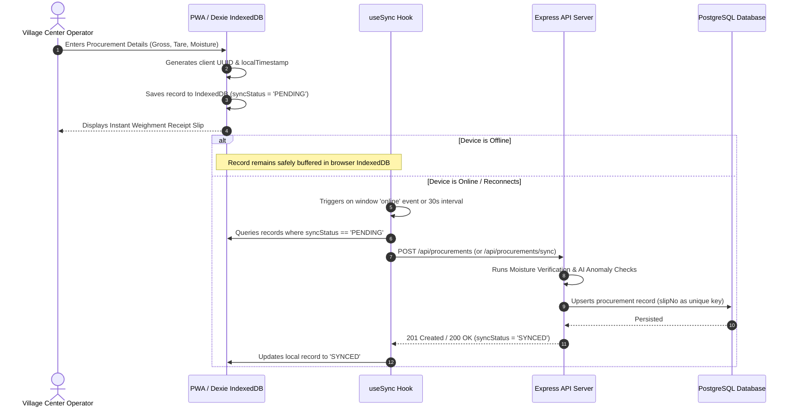

# 🏛️ System Architecture & Engineering Design

This document details the end-to-end system architecture, component design, data models, offline synchronization protocol, business algorithms, and security frameworks of the **Farmer Procurement Application (FPC PWA)**.

---

## 1. Executive Summary & Design Goals

A Farmer Producer Company (FPC) procures grains and agricultural commodities from thousands of smallholder farmers across distributed rural village collection centers. These collection centers frequently suffer from **zero or intermittent cellular connectivity**, leading to paper-based weighment slips, manual moisture calculations, rate discrepancies, and delayed bank payments (averaging 12–14 days).

### Core Architectural Objectives
- **100% Offline Resilience:** Village center operators must be able to register farmers and issue legal weighment receipts without active internet connectivity.
- **Data Integrity & Fraud Prevention:** Eliminate manual calculation errors via deterministic backend formulas, enforce centralized pricing, and detect suspicious yield/velocity anomalies via algorithmic heuristics.
- **DPDP Act 2023 Compliance:** Adhere to India's Digital Personal Data Protection Act by avoiding sensitive national identifiers (Aadhaar) and using cryptographic pseudonymous IDs (`F-XXXXX`).
- **Rapid Bank Settlement:** Compress payment processing times from **12 days to under 2 days** through automated bank verification and single-click NEFT/RTGS batch file generation.

---

## 2. High-Level System Architecture

The application adopts a **hybrid distributed edge architecture**: client devices run an offline-first Progressive Web App (PWA) backed by local browser IndexedDB storage, while the central cloud/server infrastructure runs a containerized microservice cluster behind an Nginx reverse proxy.



---

## 3. Component Deep Dive

### 3.1 Client Layer (Frontend PWA)
- **Framework:** React 19 bundled with Vite 8.
- **Storage Layer (IndexedDB):** Powered by **Dexie.js v4**, maintaining local tables for `farmers`, `procurements`, `prices`, and `user`.
- **Service Worker Lifecycle:** Managed via `vite-plugin-pwa` with Workbox. Precaches the complete static bundle (HTML, JavaScript, CSS, SVGs, icons) to allow instant cold starts even when airplane mode is enabled.
- **UI & Typography:** High-contrast government portal design conforming to W3C Web Content Accessibility Guidelines (WCAG 2.1 AA). Dual Marathi (मराठी) and English labels eliminate language barriers for rural operators.

### 3.2 Gateway & Reverse Proxy (Nginx)
- **Static Asset Delivery:** Serves the compiled Vite production bundle with 1-year immutable caching (`Cache-Control: public, immutable`).
- **Service Worker Safety:** Disables caching on `sw.js` (`Cache-Control: no-cache, no-store, must-revalidate`) to guarantee immediate client updates upon new deployments.
- **API Proxy:** Routes all requests matching `/api/*` to the upstream Node.js backend container (`http://backend:5000`), terminating CORS requirements and simplifying deployment.
- **SPA Fallback Routing:** All non-file URI requests fall back to `/index.html` to support client-side React Router navigation.

### 3.3 Application Server (Node.js & Express)
- **Architecture:** Model-View-Controller (MVC) pattern.
- **Strict Validation & Coercion:** Powered by **Zod**, coercing string inputs from HTML forms into strongly-typed primitives before execution.
- **Security:** JWT (JSON Web Tokens) with 30-day expiration, salted password hashing via `bcryptjs` (10 rounds).

### 3.4 Data Persistence (PostgreSQL & Prisma ORM)
- **Engine:** PostgreSQL 15 running in Alpine Linux.
- **ORM:** Prisma v6, maintaining strict relational integrity, foreign key cascades, and unique constraints.
- **Decimal Precision:** All weights are stored as `Decimal(10, 1)` to prevent floating-point weighment drift. All monetary amounts are stored as `Decimal(15, 2)` (paisa accuracy).

---

## 4. Entity-Relationship (ER) Data Model



---

## 5. Offline-First Synchronization Protocol

The application utilizes an **event-driven optimistic synchronization protocol** ensuring zero data loss during field network drops.



### Idempotency & Conflict Resolution
1. **Unique Key Generation:** Every slip creates an unforgeable alphanumeric `slipNo` (`SLIP-` + timestamp suffix).
2. **Upsert Semantics:** The backend synchronization endpoint uses PostgreSQL `UPSERT` (`INSERT ... ON CONFLICT (slipNo) DO UPDATE`). If a slow connection triggers repeated synchronization of the same slip, the transaction updates the existing record rather than generating duplicate entries.
3. **Primary Key Reconciliation:** When farmers are registered offline, temporary client IDs (`temp_1712...`) are stored locally. Upon synchronization, the server-assigned UUID replaces the temporary ID in Dexie, automatically updating foreign keys across pending local procurement records.

---

## 6. Business Logic & Algorithmic Engines

### 6.1 Moisture Deduction Engine
Indian agricultural standards set acceptable grain moisture at **12.0%**. Grains with moisture exceeding 12% spoil in warehouses and carry excess water weight.
- **Rule:** For every 1.0% moisture exceeding 12.0%, exactly 1.0% weight penalty is deducted from the net produce weight:
  $$\text{Net Weight} = \text{Gross Weight} - \text{Tare Weight}$$
  $$\text{Deduction \%} = \max(0, \text{Moisture} - 12.0)$$
  $$\text{Final Paid Weight} = \text{Net Weight} \times \left(1 - \frac{\text{Deduction \%}}{100}\right)$$

### 6.2 Price Determination
- Central rates are published per **Quintal** ($1\text{ Quintal} = 100\text{ Kilograms}$).
- Total disbursement calculation:
  $$\text{Total Amount (₹)} = \left(\frac{\text{Final Paid Weight (kg)}}{100}\right) \times \text{Rate per Quintal (₹)}$$

### 6.3 AI Anomaly & Fraud Detection Engine
Procurement fraud typically manifests in two ways: middlemen bringing outside grains under a smallholder farmer's quota, and operators duplicating scale weighments. The backend runs algorithmic heuristic checks before saving each transaction:

```
                          ┌──────────────────────────┐
                          │   Incoming Procurement   │
                          └─────────────┬────────────┘
                                        │
                         Is Net Weight / Land Area >
                              2,500 kg / Hectare?
                               /             \
                             YES              NO
                             /                 \
        [Flag: High yield for land size]        │
                             \                 /
                              ▼               ▼
                        Did this Farmer submit produce
                             within past 60 minutes?
                               /             \
                             YES              NO
                             /                 \
       [Flag: Farmer appeared twice in 1 hr]    │
                             \                 /
                              ▼               ▼
                        Save with AI Flags & Reason
```

---

## 7. Security, Privacy & DPDP Act 2023 Compliance

| Area | Security Measure |
|---|---|
| **Identity Privacy** | **Zero Aadhaar Storage.** To comply with India's Digital Personal Data Protection Act 2023, Aadhaar numbers are neither requested, transmitted, nor saved. Farmers are identified solely by company-issued codes (`F-XXXXX`). |
| **Authentication** | Passwords salted and hashed with `bcryptjs` (cost factor 10). Authentication sessions issued via signed JWT bearer tokens with 30-day lifetime. |
| **Access Control (RBAC)** | Strict role segregation: `CENTER_OPERATOR` permissions are limited to produce weighment and farmer intake. Only `OFFICE_MANAGER` users can publish prices, verify bank details, and approve disbursements. |
| **Financial Safeguard** | **Bank Verification Barrier:** An operator cannot select or create a procurement record for any farmer whose bank details are not marked `isVerified = true` by the Office Manager. |

---

## 8. Deployment Topology & Docker Orchestration

The application deploys as an isolated multi-container stack orchestrated via `docker-compose.yml`:

```
┌────────────────────────────────────────────────────────┐
│               DOCKER VIRTUAL NETWORK                   │
│                                                        │
│   ┌────────────────┐      ┌─────────────────────────┐  │
│   │   frontend     │      │         backend         │  │
│   │ (Nginx 1.27)   │─────▶│   (Node 22 / Express)   │  │
│   │ Port 80:80     │      │       Port 5000:5000    │  │
│   └────────────────┘      └────────────┬────────────┘  │
│                                        │               │
│                                        ▼               │
│                           ┌─────────────────────────┐  │
│                           │        postgres         │  │
│                           │   (PostgreSQL 15 Alpine)│  │
│                           │       Port 5432:5432    │  │
│                           │   Volume: postgres_data │  │
│                           └─────────────────────────┘  │
└────────────────────────────────────────────────────────┘
```

- **Healthcheck Synchronization:** The backend container waits for PostgreSQL to pass native health checks (`pg_isready`) before launching, eliminating boot-order connection crashes.
- **Zero-Config Startup:** Backend container startup automatically executes `prisma db push` to synchronize table schemas and runs `prisma/seed.js` to ensure immediate test readiness.
